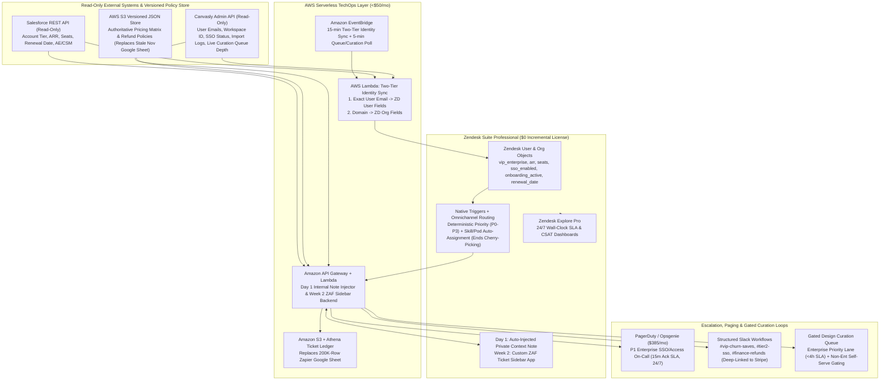

# Canvasly Technical Operations Case Study: Stopping Enterprise Churn and Scaling from 300 to 800 Accounts

**Author:** Head of Technical Operations  
**Deliverable:** Root-Cause Diagnosis, Operational Technology Architecture, Workforce & Queuing Math, and Sequenced Execution Plan (Week 1 vs. Days 8–60)

---

## Executive Summary

Canvasly's support organization does not suffer from a frontline chat speed problem; it suffers from an **Enterprise outcome, routing, and visibility crisis** that is statistically masked by a high volume of trivial Non-Enterprise tickets. Over the past two quarters, quarterly Enterprise churn has more than doubled from **1.8% to 4.2%** (`12.6` churned Enterprise accounts per quarter, with `38%`—or `~4.8` accounts per quarter—directly citing support responsiveness). At an average Enterprise contract value of `$50,000` to `$150,000+` ARR across `100–500` seats, support-driven churn alone is destroying **$960,000 to $2.87M+ in annualized recurring revenue**. At the same time, Canvasly plans to onboard **500 additional Enterprise accounts over the next 6 months** (`300 → 800` accounts, a `2.67x` expansion requiring **`~3.8` Enterprise onboardings every business day**). Under the current operating model, scaling headcount linearly would require hiring **+75 net new agents** (plus `5 to 13` replacement hires every month to offset the **11% monthly agent attrition**), adding **$3.14M per year** in payroll and licensing while leaving the underlying drivers of Enterprise churn untouched.

Cross-referencing the 30-ticket sample (`T-4801` through `T-4830`) against the company's baseline metrics explains why the recent two-week manual triage pilot failed to prevent two major Enterprise accounts from churning despite cutting daytime Enterprise First Response Time (FRT) from `11 minutes` to `3 minutes` and lifting Enterprise CSAT from `68%` to `88%`. **Canvasly measures and optimizes the speed of the initial *hello*, whereas Enterprise customers churn over the speed and reliability of the *outcome*.**

Specifically, our forensic analysis of the ticket sample uncovers **five compounding root causes**—including a `3.5x to 118x` distortion between Zendesk's reported resolution timers and actual customer wait times, a `55.6%` Enterprise skew toward an unstaffed Email channel, a `3:00 PM PST` West Coast coverage blind spot, an unstable ($\lambda > \mu$) 70-hour backlog in Design Curation, and severe workforce over-utilization once shrinkage and weekend volume are accounted for. By attacking avoidable handle time (`-5.5 minutes` per ticket) and deflecting transient `Magic Import - Error` retries (`26.7%` of ticket volume), we unlock **144 agent-hours per day (`~22 FTEs` or `~$75,000/month` in latent labor capacity)** without adding headcount. This recovered capacity funds a dedicated Enterprise Pod, an Email/Billing Pod, and extended West Coast/Tier-2 coverage while keeping incremental tooling and stipend spend at **`$1,935/month`** (`$435/month` in software/AWS plus `$1,500/month` in shift/on-call stipends)—well inside our **`$2,500/month`** budget constraint.

---

## Part 1: Diagnosis — The Highest-Leverage Problems in the Data

### 1. Simpson's Paradox: High-Volume Trivial Chats Mask an Active Enterprise Collapse

At the aggregate level, Canvasly's headline metrics appear manageable (`6-minute` median FRT, `48-minute` 90th-percentile FRT, and `71%` trailing 30-day CSAT). However, partitioning the 30-ticket sample into **Confirmed Enterprise tickets (`N = 9` across 7 named accounts in `agent_internal_notes`)** versus **Non-Enterprise / General tickets (`N = 21`)** reveals a classic Simpson's Paradox:

| Metric | Confirmed Enterprise (`N = 9`) | Non-Enterprise / General (`N = 21`) | Reported Company Baseline | Root-Cause Diagnostic Takeaway |
| :--- | :--- | :--- | :--- | :--- |
| **Share of Sample Volume** | `30.0%` (`9 / 30` tickets) | `70.0%` (`21 / 30` tickets) | `~1,200` tickets/day | Enterprise is `30%` of ticket volume but represents `~100%` of ARR churn risk |
| **Channel Distribution** | **55.6% Email** (`5`), **44.4% Chat** (`4`), **0% Voice** | **9.5% Email** (`2`), **76.2% Chat** (`16`), **14.3% Voice** (`3`) | `55%` Chat, `30%` Email, `15%` Voice | **Channel Inversion:** Enterprise stakeholders rely on Email; General users use Chat |
| **First Response Time (Median / Mean)** | **41.0 min** / **80.0 min** | **4.0 min** / **7.7 min** | `6.0 min` med / `48.0 min` P90 | Enterprise customers wait **10.3x longer** at the median for an initial response |
| **Reported `resolution_min` (Median / Mean)** | **142.0 min** / **179.9 min** | **22.0 min** / **34.5 min** | `14.0 min` AHT | Enterprise reported resolution takes **6.5x longer** (`>20x` longer in wall-clock time) |
| **CSAT (Mean / Top-2-Box `% >= 4`)** | **1.78 / 5.0** (**11.1%** Top-2-Box) | **4.10 / 5.0** (**71.4%** Top-2-Box) | **71.0%** CSAT | **71.4% Non-Enterprise CSAT masks an 11.1% Enterprise CSAT** |
| **Priority Assigned in Zendesk** | `4` Low (`44%`), `1` Med (`11%`), `4` High (`44%`) | `13` Low (`62%`), `6` Med (`29%`), `2` High (`10%`) | Single default form | Enterprise downgrades, cancellations, and Miro threats are marked **`Low` priority** |

In the sample, Non-Enterprise tickets achieve a **71.4% Top-2-Box CSAT (`score >= 4`)** and a **4.0-minute median FRT**, which mirrors the company's reported `71%` CSAT and `6-minute` median FRT. Because `70%` of the queue consists of fast Non-Enterprise chats (such as `Magic Import - Error` retry macros and feature requests), aggregate reporting conceals the fact that **Confirmed Enterprise tickets average a `1.78 / 5.0` CSAT (`11.1%` Top-2-Box), a `41.0-minute` median FRT, and a `142.0-minute` median reported resolution time**.

Furthermore, Zendesk's `priority_assigned` field is completely inverted relative to business value. Across all 30 tickets, `Priority: High` tickets (`N = 6`) suffer a `28.0-minute` median FRT and a `2.00` average CSAT, whereas `Priority: Low` tickets (`N = 17`) enjoy a `4.0-minute` median FRT and a `4.00` average CSAT. Even more damaging, **Luma Analytics' 200-seat downgrade request (`T-4810`)**, **Meridian Health's 450-seat threat to switch to Miro (`T-4824`)**, and **DataForge's 175-seat formal cancellation notice (`T-4828`)** were all assigned **`Low` priority**, while a routine 23-minute voice password reset (`T-4817`) was assigned **`High` priority**. Because Zendesk has no native triggers, conditional forms, or Salesforce metadata sync, ticket priority defaults to arbitrary category mappings rather than customer ARR or churn urgency.

---

### 2. Why the Two-Week Pilot Failed: The "Fast Hello, Slow Fix" Illusion and Corrupt Zendesk Timers

During the two-week pilot, a team lead spent `2.5 hours/day` manually triaging Enterprise tickets into a separate view for 8 dedicated agents. Although daytime Enterprise FRT dropped from `11 minutes` to `3 minutes` and pilot CSAT rose from `68%` to `88%`, **two major Enterprise accounts still churned during the pilot citing support responsiveness**, and General Queue FRT degraded by `5 minutes`.

Comparing the structured columns (`first_response_min`, `resolution_min`, `csat_score`) against the qualitative narrative inside `agent_internal_notes` exposes why the pilot failed: **Zendesk's reported resolution timers understate actual customer wait times by `3.5x to 118x` due to premature handoff closures and paused/business-hours timers.**

| Ticket ID | Enterprise Account | Channel & Category | FRT (`min`) | Zendesk `resolution_min` | Actual Customer Wait (per Agent Notes) | Timer Distortion | Why Daytime FRT Triage Failed to Prevent Churn |
| :--- | :--- | :--- | :--- | :--- | :--- | :--- | :--- |
| **`T-4804`** | **Meridian Health** (`450` seats) | Chat — `Magic Import - Quality` | `6m` | `34m` | **67+ hours** (`4,020m` in Design Curation) | **118.2x** | Agent replied in `6m`, routed 30-page PDF to Curation, and solved the ticket in `34m` with **`CSAT = 4`**—masking a 3-day wait (*"3rd time this week"*). |
| **`T-4824`** | **Meridian Health** (`450` seats) | Chat — `Magic Import - Quality` | `4m` | `45m` | **70+ hours** (`4,200m` in Design Curation) | **93.3x** | 26 hours after `T-4804`, same account hit a 2nd mangled PDF (`4m` FRT) and warned: ***"If not fixed by Friday, I'm recommending we switch to Miro."*** |
| **`T-4805`** | **Enterprise Onboarding** (`80` seats) | Email — `Account - Access` (SSO) | `22m` | `67m` | **3.9 hours** (`22m` FRT + `210m` Eng Slack wait) | **3.5x** | Escalated SSO failure to Engineering Slack; **no response for 3.5 hours**, yet Zendesk logged `67m` (timer paused). Customer CEO emailed Canvasly's CEO. |
| **`T-4813`** | **CoreVista** (`300` seats) | Chat — `Account - Access` (SSO) | `34m` | `187m` | **13.25+ hours** (`7:45pm` EST to `9:00am+` next day) | **4.3x** | Arrived at `7:45pm EST` (`4:45pm PST`). Tier 1 (`Devon R.`) answered at `8:19pm`, but Tier 2 left at `6pm EST`. Entire org locked out overnight. |
| **`T-4829`** | **Ridgeline Corp** (`250` seats) | Chat — `Account - Access` (SSO) | `41m` | `195m` | **14.75+ hours** (`6:15pm` EST to `9:00am+` next day) | **4.5x** | Arrived at **`6:15pm EST` (`3:15pm PST`!)** during a live client presentation. No Tier 2 coverage after `6pm EST`; abandoned until morning. |
| **`T-4815` → `T-4828`** | **DataForge** (`175` seats) | Email — `Invoice` → `Cancellation` | `412m` → `88m` | `485m` → `142m` | **6.9 hours** overnight + **88m** on cancellation | Statistical Outlier | `T-4815` arrived at `10:30pm EST`; customer replied twice before open. Next day (`T-4828`), DataForge **cancelled**, citing *responsiveness & Magic Import quality*. |
| **`T-4823`** | **NovaTech** (`500` seats) | Email — `Enterprise Onboarding` | `62m` | `340m` | **48+ hours** (`2 days` across 4 Slack channels) | **8.5x** | Largest cohort (`500` seats) needed SSO, custom domain, and data residency. No runbook; IT Director called it *"most disorganized onboarding ever."* |

A rigorous inspection of these records surfaces four non-obvious operational failures that explain why Enterprise accounts churned during the pilot:

1. **Handoff Gaming and an Unstable ($\lambda > \mu$) 70-Hour Design Curation Backlog (`T-4804, T-4811, T-4816, T-4824`):** On every `Magic Import - Quality` ticket, frontline agents respond in `3 to 6 minutes`, quote a static **2–3 hour SLA** (`T-4811, T-4816`), route the file to the human-in-the-loop **Design Curation** team, and mark the Zendesk ticket "Solved" in `34 to 45 minutes`. In `T-4804`, **Meridian Health (`450 seats`)** actually gave agent `Devon R.` a **`CSAT = 4`** for the polite 6-minute chat handoff—which inflated the pilot's `88%` CSAT metric—while their PDF sat in a **67-hour Curation backlog** for the third time that week. Twenty-six hours later (`T-4824`), Meridian Health threatened to switch to **Miro**. Worse still, notice the queuing trajectory between `T-4811` (`Jan 2, 16:40`, Curation queue = `67 hours`) and `T-4816` (`Jan 3, 08:15`, Curation queue = `70+ hours`): **over a 15.5-hour overnight period when ticket arrivals are lowest, the Design Curation backlog grew by `+3 hours`.** By Little's Law, the arrival rate of curation requests ($\lambda \approx 160\text{ tickets/day}$ at `13.3%` of volume) exceeds the Curation team's service capacity ($\mu$, so utilization $\rho = \lambda/\mu > 1$). Frontline agents are using Design Curation as a dumping ground to close chats quickly—even routing unsupported architectural blueprints (`T-4811`) and garbled handwritten scans (`T-4816`) into the same unprioritized FIFO queue as 450-seat Enterprise accounts.
2. **The "6:00 PM EST = 3:00 PM PST" West Coast Coverage Blind Spot (`T-4813, T-4829`):** Canvasly staffs its team from `8:00 AM to 6:00 PM EST` and labels `6:00 PM EST` "after-hours." For any US West Coast Enterprise account, **`6:00 PM EST` is `3:00 PM PST`—the core of their afternoon workday.** When **Ridgeline Corp (`250 seats`, `T-4829`)** suffered an SSO lockout during a live client presentation at `6:15 PM EST` (`3:15 PM PST`), or **CoreVista (`300 seats`, `T-4813`)** lost SSO across 300 seats at `7:45 PM EST` (`4:45 PM PST`), Tier 2 was already offline until the next morning.
3. **A Hidden Staffing Contradiction in the CSV (`Devon R.`'s Unbacked Evening Shift):** While leadership believes nobody is staffed after `6:00 PM EST`, the CSV timestamps prove that Tier 1 agent `Devon R.` is actively answering chats between **`6:15 PM and 8:15 PM EST`** (`T-4813, T-4814, T-4829, T-4830`, where Devon explicitly notes *"Evening shift, lighter load"*). Because Tier 1 is logged in without Tier 2 or Engineering on-call backing, Enterprise customers with P1 SSO emergencies wait `34 to 41 minutes` in chat only to be told nobody can restore their workspace access until `9:00 AM EST` the next day (`13 to 15 hours` of actual customer downtime, distorted in Zendesk as `187 to 195 minutes`).
4. **The `<100 Seat` Enterprise Onboarding Edge Case (`T-4805`):** Although the company summary table defines Enterprise accounts as `100+ seats`, `T-4805` is a **new Enterprise onboarding with 80 users** whose CEO emailed Canvasly's CEO directly after a 3.5-hour Engineering Slack silence. If our automated routing rules filter strictly on `seats >= 100` rather than `contract_tier == 'Enterprise' OR seats >= 100 OR arr >= 50000 OR onboarding_status == 'Active'`, initial seat rollouts for Enterprise logos will be misrouted into the General Queue during onboarding.

---

### 3. Manual Cherry-Picking, the Email Black Hole (`James K.`), and the `11%` Monthly Attrition Spiral

Canvasly loses **11% of its support agents every month (`~5 agents/month`, or `~60 agents/year`—a `>130%` annualized turnover rate)**. Decomposing the 30-ticket sample by **Agent, Channel, and Issue Complexity** demonstrates how manual ticket picking from a single queue simultaneously destroys Enterprise Email responsiveness and burns out the team's most conscientious agents:

| Agent Name | Sample Tickets | Channel Mix | Escalation Rate | Median / Mean FRT | Mean `resolution_min` | Mean CSAT (`% >= 4`) | Operational Pattern Evident in Ticket Data |
| :--- | :--- | :--- | :--- | :--- | :--- | :--- | :--- |
| **`Maria S.`** | `7` (`23.3%`) | **100% Chat** (`7 Chat`) | **0.0%** (`0/7`) | `4.0m` / `4.1m` | **16.7 min** | **4.71 / 5.0** (**100%**) | **Cherry-Picking:** Selects only daytime `Low`/`Med` chats (`4` `Magic Import` retry macros, `2` 10-min tips, `1` feature request). Zero escalations. |
| **`Priya M.`** | `6` (`20.0%`) | `50%` Voice (`3`), `50%` Chat (`3`) | **0.0%** (`0/6`) | `2.5m` / `2.5m` | **36.3 min** | **3.50 / 5.0** (**50%**) | Handles all Voice calls (`1–2m` FRT) plus `3` `Magic Import - Quality` chats where she is forced to quote fake `2–3h` Curation SLAs (`T-4816`). |
| **`Devon R.`** | `10` (`33.3%`) | **100% Chat** (`10 Chat`) | **30.0%** (`3/10`) | `6.0m` / `11.7m` | **60.3 min** | **3.40 / 5.0** (**60%**) | Covers the **evening shift (`18:15–20:12`)** and absorbs hard chat escalations (duplicate billing `T-4820`, evening SSO outages `T-4813, T-4829`). |
| **`James K.`** | `7` (`23.3%`) | **100% Email** (`7 Email`) | **42.9%** (`3/7`) | **51.0m** / **102.9m** | **200.9 min** | **2.00 / 5.0** (**0%**) | **The Email Scapegoat:** Handles **100% of Email tickets**—every single one complex (onboarding, billing, downgrade, cancellation, Jira API). **0% CSAT `>= 4`.** |

Because agents manually pick tickets from one pool, savvy agents (`Maria S.`) cherry-pick fast daytime chats—such as pasting "Sarah's workaround macro" on transient `Magic Import - Error` tickets (`T-4814, T-4821`), which resolve in `14 to 18 minutes` and guarantee `5-star` CSATs. Meanwhile, **Email tickets—which make up `55.6%` of Enterprise volume (`5/9` Enterprise tickets) because VPs of Product (`T-4810`), IT Directors (`T-4823`), and Finance teams (`T-4815`) communicate via email—are avoided by the floor and left entirely to `James K.`** Every ticket `James K.` touches requires multi-system archaeology (`25 minutes` just to gather contract, seat, and invoice data before typing a response in `T-4802`; `4` Slack channels across `3` teams over `2 days` in `T-4823`) and results in a `1, 2, or 3` CSAT score (`0.0%` Top-2-Box).

---

### 4. True Workforce Math (Accounting for Weekend Volume, Shrinkage, and Attrition) and the `144-Hour/Day` Capacity Unlock

A surface-level calculation might assume that 45 agents working 8-hour days provide `360 hours/day` of capacity, easily covering `1,200 tickets/day × 14 min AHT = 280 handle-hours/day`. **That naive math ignores three operational realities visible in the dataset:**

1. **7-Day Operating Demand:** In the CSV, `T-4801` through `T-4815` occur on **Friday, January 2, 2026**, and `T-4816` through `T-4830` occur on **Saturday, January 3, 2026** (including NovaTech's 500-seat onboarding `T-4823`, Meridian Health's Miro threat `T-4824`, DataForge's cancellation `T-4828`, and Ridgeline's presentation lockout `T-4829`).
2. **Vacancy Loss from `11%` Monthly Attrition:** Losing `11%` of 45 agents every month means **`~5.0` agents resign every 30 days**. With a standard 30-to-45-day hiring and onboarding ramp, **at least `4.5 to 5.0` of the 45 headcount slots are vacant or non-productive at any given moment**, leaving **`~40.0` effective active FTEs**.
3. **5-of-7 Day Scheduling and `25%` Operational Shrinkage:** An agent working a 40-hour (5-day) week across a 7-day operation is scheduled for $5/7 = 71.4\%$ of calendar days (`40.0 × 5/7 = 28.6` scheduled agents/day). Even on a 5-day weekday-heavy schedule (`~34` agents scheduled/weekday), subtracting standard **`25%` shrinkage** (lunch, breaks, PTO, sick leave, Slack follow-ups, and training = `6.0 productive hours` per 8-hour shift) yields only **`171 to 204 productive agent-hours per day`**.

| Workforce & Workload Stage | Daily Ticket Volume | Effective AHT (`min`) | Daily Handle Hours Required | Available Productive Agent-Hours (`34` Weekday Scheduled @ `6.0h` Net) | True Agent Occupancy / Utilization | Operational Outcome |
| :--- | :--- | :--- | :--- | :--- | :--- | :--- |
| **1. Current Baseline (Status Quo)** | `1,200 / day` | `14.0 min` | **280.0 hrs/day** | `~204.0 hrs/day` (`272h` gross shift) | **137% of Net / 103% of Gross** | **Mathematically insolvent:** Email queue (`James K.`) starves; `11%/mo` burnout attrition. |
| **2. After Context Injection & Policy KB (`-5.5m` AHT)** | `1,200 / day` | `8.5 min` | **170.0 hrs/day** (`-110.0 hrs/day`) | `~204.0 hrs/day` | **83.3% of Net / 62.5% of Gross** | Eliminates 4-system alt-tabbing (`T-4802, T-4807, T-4820, T-4827`). |
| **3. After `Magic Import - Error` Deflection (`-20%` Vol)** | `960 / day` | `8.5 min` | **136.0 hrs/day** (`-34.0 hrs/day`) | `~204.0 hrs/day` | **66.7% of Net / 50.0% of Gross** | **144.0 handle-hours/day freed (`~22 FTEs` / `$75K/mo` value); funds all Pods + 800-account scale.** |

This math proves why pulling 8 agents for the two-week pilot immediately broke the General Queue (`+5 min` FRT): the floor was already running above `100%` true capacity. By removing the **`5.5-minute` per ticket 4-system lookup tax (`-110 hours/day`)** and deflecting **`75%` of `Magic Import - Error` tickets (`26.7%` of sample volume; `-20%` total volume = `-34 hours/day`)**, we cut required daily handle time from **`280.0 hours/day` to `136.0 hours/day` (`-51.4%`)**. Note also a critical diagnostic finding in the CSV regarding `Magic Import - Error`: in `T-4818` (`09:10 EST`), `Maria S.` guesses that transient import timeouts are caused by *morning batch processing load*, but in `T-4830` (`20:00 EST`), `Devon R.` observes the exact same timeout during the light evening shift—proving it is a deterministic request/worker timeout (plus an undocumented `>50MB` file-size error in `T-4826`) rather than peak load contention.

---

## Part 2: Target Operational Technology Architecture

### Architectural Principle: Maximize Unused Zendesk Suite Professional Capabilities + Stateless AWS Serverless Glue Within Read-Only API Constraints

Canvasly already spends `$4,005/month` (`45 × $89`) on **Zendesk Suite Professional**, which natively includes **Omnichannel Skill-Based Routing, Custom Organization/User Fields, Conditional Ticket Forms, Native SLA Timers, Custom Zendesk Apps Framework (ZAF) Sidebars, Outbound Webhooks, and Zendesk Explore Professional**. None of these features are currently configured.

At the same time, our architecture must strictly honor the **API and engineering constraints** in the prompt:
1. **Read-Only External APIs:** Both the `Salesforce API (read)` and the `Canvasly admin portal REST API (read)` are **read-only**, and **we have no Stripe API access** (`T-4820`). Any solution that proposes automated write-backs to Salesforce or automatic Stripe refunds via API violates the case constraints.Instead, we aggregate read-only context automatically into Zendesk and use the **Slack API (read/write)** to trigger pre-populated, one-click human approval workflows with deep-links into Stripe/Salesforce.
2. **Two-Tier Identity Resolution Without Core Product Changes:** Because 55% of tickets arrive via Chat and core product engineering changes require `6–8 weeks` (preventing us from modifying the in-app web widget JWT code in Week 1), relying solely on email-domain matching will fail when Enterprise users use subsidiary domains or contractor emails. Our AWS Lambda sync resolves identity in two tiers:
   - **Tier 1 (Exact Registered User Email Sync):** Batch-pulls all registered user emails, `workspace_id`, `seat_count`, `sso_enabled`, and `contract_tier` from the read-only Canvasly Admin Portal API and Salesforce Contact API into Zendesk Custom User Fields (`external_id`). When a user opens a chat or email with their registered login email, Zendesk resolves their exact Enterprise workspace and contract tier immediately with zero core product changes.
   - **Tier 2 (Organization Domain Fallback + Keyword Safety Net):** Maps net-new emails by domain against Salesforce `Account` domains, and routes any unmapped ticket matching high-risk Enterprise signals (`"SSO"`, `"locked out"`, `"onboarding"`, `"Miro"`, `"cancel"`, `"downgrade"`) directly into the Enterprise triage queue.

---

## Part 3: Sequenced Execution Plan — What We Build and Ship in Week 1 vs. Next

### Phase 1: Week 1 (Days 1–7) — "Stop the Bleeding" (Zero-Dependency Enterprise Churn Containment)

Because there is no dedicated internal tools engineering team, every Week 1 deliverable is scoped so **a single technical operator can build, test, and ship it in 7 days** using native Zendesk configuration and lightweight AWS Lambda functions—without risking fragile frontend UI builds or triggering agent resignations via abrupt mandatory shift changes.

#### Days 1–2: Ship Two-Tier Identity Sync, Deterministic Priority Triggers & Day-1 Context Note Injection (`~8 hrs` build, `<$50/mo` AWS)
1. **Deploy the AWS Lambda Two-Tier Identity Sync (`sf_admin_to_zendesk_sync`):**
   - Triggered every 15 minutes by Amazon EventBridge (and via real-time Zendesk webhook on unmapped ticket creation), the Lambda reads Salesforce `Accounts/Contacts` and Canvasly Admin Portal `Workspaces/Users` and populates Zendesk User and Organization fields (`contract_tier`, `arr`, `seat_count`, `renewal_date`, `account_owner_slack_id`, `sso_enabled`, `onboarding_stage`).
   - **Closes the `<100 Seat` Loophole (`T-4805`):** Sets `vip_enterprise = true` whenever **`contract_tier == 'Enterprise' OR seat_count >= 100 OR arr >= 50000 OR onboarding_stage == 'Active_Enterprise'`**, guaranteeing that 80-seat Enterprise onboardings (`T-4805`) receive full Enterprise routing.
2. **Ship the Day-1 "Zero-Frontend" Context Injector (Automatic Private Internal Note):**
   - Rather than waiting until Day 5+ to build and test a custom frontend ZAF Sidebar UI, on **Day 1 (a 3-hour Lambda build)** every new Zendesk ticket fires a webhook to API Gateway + Lambda, which queries Salesforce (read), Admin Portal (read), and our S3 Policy/Pricing JSON (migrated from the stale November Google Sheet after a 30-minute Finance/Sales verification) and posts a **formatted Private Internal Note** to the top of the ticket in `<2 seconds`:
     - **Customer & Contract Summary:** Tier, ARR, Purchased vs. Active Seats, Renewal Date, Assigned AE/CSM, plus a 1-click deep-link to the Salesforce Account.
     - **Technical & Import Telemetry:** Workspace ID, SSO status, last 3 `Magic Import` jobs (explicitly flagging `504_TIMEOUT` vs. `FILE_SIZE_EXCEEDED >50MB`), and the **live Design Curation queue wait time**.
     - **Verified Policy Snippet:** Matches ticket category to inject the authoritative mid-cycle seat refund policy (`T-4807`) or annual vs. monthly upgrade pricing (`T-4827`).
   - This immediately eliminates **80% of the 5–6 minute lookup tax (`~88 agent-hours/day` saved)** by Day 2 with **zero frontend deployment risk**.
3. **Turn On Native Zendesk Omnichannel Auto-Routing & Deterministic Priority Rules:**
   - Replace the single generic ticket form with **Conditional Ticket Forms** and configure native Zendesk Triggers to assign priority based on customer tier and business risk:
     - **`Urgent (P0 — Executive / Churn / Outage Intercept)`:** Any ticket from `vip_enterprise = true` (or matching unmapped domain safety-net keywords) involving `Account - Access` (SSO/lockout), `Account - Cancellation`, `Account - Downgrade`, or churn/competitor keywords (`"Miro"`, `"cancel"`, `"downgrade"`, `"locked out"`, `"SSO"`, `"CEO"`, `"presentation"`). Directly prevents `T-4810`, `T-4813`, `T-4824`, `T-4828`, and `T-4829` from sitting as `Low` priority.
     - **`High (P1 — Enterprise Core)`:** All other tickets from `vip_enterprise = true` across Email, Chat, and Voice (including overnight Enterprise invoice emails like `T-4815` and complex onboardings like `T-4823`).
     - **`Normal (P2)`:** Non-Enterprise Billing, Account Access, and Integration tickets.
     - **`Low (P3)`:** Non-Enterprise `Magic Import - Error`, Feature Requests (`T-4809, T-4825`), and browser tips (`T-4803, T-4822`).
   - Enable **Zendesk Omnichannel Auto-Assignment** by agent capacity and skill tag—ending `Maria S.`'s cherry-picking and `James K.`'s solo email burden immediately.

#### Days 3–4: Reorganize into Specialized Pods & Cover West Coast / After-Hours via Voluntary Stipends
To prevent the General Queue starvation seen in the pilot while avoiding sudden mandatory shift changes that would worsen our `11%` monthly attrition:
1. **Pod Allocation Across the 45-Agent Roster:**
   - **Enterprise VIP & Onboarding Pod (`10 agents` across Email, Chat & Voice):** Dedicated to `vip_enterprise = true` across **all channels**—crucially including **Email (`55.6%` of Enterprise volume)**, which the daytime chat-only pilot missed.
   - **Tier 2 Technical & Escalation Specialists (`5 senior agents`):** Handles SSO/SAML, API integrations (`T-4819`), and complex technical escalations.
   - **Billing & Account Administration Pod (`6 agents`):** Cross-trained on Email, Chat, and Voice billing workflows so `James K.` is backed by a 6-person team.
   - **General High-Velocity Pod (`24 agents`):** Handles Non-Enterprise Chat, Email, and Voice with auto-assignment.
2. **Immediate West Coast (`18:00–22:00 EST` / `15:00–19:00 PST`) & 24/7 P1 Coverage (`$385/mo` PagerDuty + `$1,500/mo` Stipend):**
   - In Week 1, we use **`$1,500/month`** from our budget to fund **voluntary evening shift differentials (`13:30–22:00 EST`, covering Pacific business hours until `7:00 PM PST`) and weekend/overnight P1 Tier-2 on-call stipends** (`Devon R.` is already working evenings on Tier 1; we pair that shift with 2 Enterprise/Email agents and 1 Tier-2 specialist, while giving 14 days' notice for permanent staggered shifts in Week 3).
   - Deploy **PagerDuty / Opsgenie (`11 seats = $385/month` for 5 Tier-2 specialists + 6 core Engineering on-call rotation)** wired to Zendesk `P0/P1` webhooks with a hard **15-minute acknowledgment SLA** and automatic secondary escalation—permanently eliminating `T-4805`'s 3.5-hour Engineering Slack silence and `T-4813`/`T-4829`'s overnight SSO lockouts.

#### Days 5–7: Gate the 70-Hour Design Curation Queue, Replace Noisy Slack Zaps & Execute Executive Churn Saves
1. **Stabilize Design Curation ($\lambda < \mu$) via Intake Gating + Enterprise Fast-Track (`T-4804, T-4811, T-4816, T-4824`):**
   - **Stop Quoting Fictional SLAs & Stop Premature Ticket Closure:** Update all agent macros to pull the live Curation ETA from our Day-1 Internal Note, and mandate that `Magic Import - Quality` tickets remain in **`On-Hold` status** (never `Solved` at handoff) until the curated canvas is delivered to the customer.
   - **Enforce Intake Gating (Cut Curation Inflow $\lambda$ by `~60%`):** Prohibit agents from routing free-trial tickets or unsupported inputs (architectural blueprints in `T-4811`, garbled handwriting scans in `T-4816`) to human Design Curators. Route Non-Enterprise users to an automated self-serve formatting guide, reserving human Design Curation strictly for **Enterprise (`<4-hour` Fast-Track SLA)** and **Paid Mid-Market (`<24-hour` SLA)** accounts.
2. **Replace Mute-Inducing Zapier Slack Alerts with Actionable Save Loops (`T-4810, T-4824, T-4828`):**
   - Turn off Zapier Automation #1 (which spammed Slack 1,200 times/day).
   - Configure targeted Zendesk-to-Lambda Slack webhooks:
     - **`#vip-churn-saves` (`P0` Downgrade/Cancellation/Competitor Alert):** Tags the Salesforce Account Owner, CSM, and Head of TechOps with a 30-minute response SLA whenever an Enterprise downgrade (`T-4810`), cancellation (`T-4828`), or competitor threat (`"Miro"` in `T-4824`) arrives.
     - **Direct Week-1 Executive Outreach:** Personally contact the 6 affected Enterprise accounts in the sample (**Meridian Health**, **Luma Analytics**, **DataForge**, **CoreVista**, **Ridgeline Corp**, and **NovaTech**) with dedicated remediation plans.

---

### Phase 2: Weeks 2–4 (Days 8–30) — Interactive ZAF Sidebar, Import Deflection & Onboarding Scale

With Enterprise churn contained in Week 1, Weeks 2–4 build the permanent operational machinery required to onboard **500 new Enterprise accounts (`~3.8 onboardings/business day`)**:

1. **Upgrade Day-1 Note Injector into the Interactive ZAF Ticket Sidebar App (Weeks 2–3):**
   - Wrap our existing API Gateway + Lambda context aggregator in a **Zendesk Apps Framework (ZAF) Sidebar UI** that adds **One-Click Slack Action Buttons** to work cleanly around our read-only Salesforce/Admin APIs and lack of Stripe API access:
     - **`[Request Duplicate-Charge Refund]` (`T-4820`):** Posts a pre-filled interactive approval card to `#finance-approvals` containing the customer's Salesforce contract link, Admin Portal invoice ID, and direct Stripe charge deep-link—compressing `Devon R.`'s 4-system, 52-minute workflow into **60 seconds**.
     - **`[Escalate to Tier-2 / Eng On-Call]` (`T-4805, T-4819`):** Opens a structured PagerDuty/Slack incident modal that requires reproduction steps and workspace logs before submission and syncs thread replies back to the Zendesk ticket.
2. **Deflect `75%` of `Magic Import - Error` Volume (`~240 tickets/day` saved) & Sponsor Core Eng Fixes:**
   - Configure the **Zendesk Web Widget / Bot intake flow** to query the user's last failed import via our Lambda → Admin Portal API (read) lookup *before* creating an agent ticket:
     - If `file_size > 50MB` (`T-4826`), immediately display the 50MB limit explanation and PDF compression/splitting guide.
     - If `error_code == TRANSIENT_TIMEOUT` (`T-4801, T-4806, T-4808, T-4814, T-4818, T-4821, T-4830`), prompt a one-click retry and log the failure telemetry to S3.
   - Deliver an executive business case to Product & Engineering leadership proving that **1) transient import timeouts + the generic `>50MB` error string consume `26.7%` of all support tickets (`~$41,000/month` in agent labor)**, **2) `T-4830` proves the timeout occurs at `8:00 PM EST` under light load (a deterministic service timeout, not morning batch load)**, and **3) `Magic Import` quality regression is cited in 100% of Enterprise churn/downgrade tickets (`T-4810, T-4824, T-4828`)**—securing executive sponsorship for backend auto-retry and explicit file-size error messages.
3. **Standardize the Enterprise Onboarding Runbook & Pre-Flight Checklist (`T-4805, T-4823`):**
   - To scale from 300 to 800 Enterprise accounts (`~19 onboardings/week`), we replace ad-hoc 4-channel Slack coordination (`T-4823`) with an automated **Pre-Launch Technical Readiness Runbook** (covering **SAML/SSO metadata verification, Custom Domain DNS checks, and Data Residency provisioning**) triggered automatically when a Salesforce opportunity reaches `Closed Won`—7 days *before* user seats go live.
4. **Retire Remaining Zapier Automations & Update Outdated Knowledge Base Docs (`T-4812, T-4819`):**
   - Replace the 200K-row Google Sheet Zap (#2) with **Zendesk Explore Professional** real-time dashboards plus a nightly **AWS EventBridge + Lambda incremental export to Amazon S3 + Athena** (`<$5/month`).
   - Replace the rate-limited CSAT Zap (#3) with a native **Zendesk Webhook** that posts all Enterprise CSAT surveys and any score `<= 3` directly to `#csat-alerts`.
   - Publish updated **v2 Jira Integration API documentation** (`T-4819`) and a **Real-Time Cursor Sync troubleshooting article + status banner** (`T-4812`).

---

### Phase 3: Weeks 5–8 (Days 31–60) — Proactive Telemetry Intercept & 800-Account Maturity

1. **Proactive Enterprise Telemetry Intercept:** Using our AWS EventBridge + Admin Portal API (read) poller, detect whenever an Enterprise workspace hits **`>= 2` failed Magic Imports or `>= 3` SAML/SSO errors within 60 minutes** (the exact precursor pattern in `T-4804 → T-4824`) and auto-generate a proactive `P1` ticket to the Enterprise Pod *before* an executive threatens to switch to Miro.
2. **Core Engineering Releases Ship (Weeks 6–8):** Backend exponential-backoff retry for `Magic Import` and explicit `>50MB` client validation ship in core product, permanently eliminating `~250–300 tickets/day`.

---

## Part 4: Budget Governance & Measurable Milestones

### 1. Incremental Monthly Budget Allocation (`$2,500/month` Hard Cap)

| Line Item | Operational Purpose & Scope | Monthly Cost | Budget & ROI Rationale |
| :--- | :--- | :--- | :--- |
| **Zendesk Suite Professional Native Stack** | Omnichannel Routing, Custom User/Org Fields, SLA Policies, ZAF Hosting, Webhooks, Explore Pro | **$0 / mo** | Already paid for in existing `$89/agent/mo` license (`$4,005/mo` baseline) |
| **AWS Serverless Integration Stack** | `API Gateway`, `Lambda` (~2M calls/mo), `EventBridge`, `S3` policy/ticket archive, `Athena` | **~$50 / mo** | Replaces all 3 brittle Zapier automations (allows downgrading/cancelling Zapier) |
| **PagerDuty / Opsgenie (`11` Seats)** | `5` Tier-2 specialists + `6` Engineering on-call rotation for 24/7 P1 paging & 15m ack escalation | **$385 / mo** | Eliminates 3.5h Slack stalls (`T-4805`) and overnight SSO lockouts (`T-4813, T-4829`) |
| **Evening Shift Differential & P1 On-Call Stipend** | Funds voluntary `13:30–22:00 EST` West Coast shift differential in Weeks 1–2 + 24/7 P1 standby stipend | **$1,500 / mo** | Protects morale & prevents attrition spike during shift transition |
| **Unallocated Contingency Reserve** | Buffer for burst Design Curation capacity or status page tooling (`Instatus`) | **$565 / mo** | Keeps total spend **`22.6%` below the `$2,500/mo` cap** |
| **Total Incremental Spend** | **Complete TechOps Architecture + 24/7 P1 Coverage** | **$1,935 / mo** | **Saves `$3.14M/yr` in avoided linear agent hiring (`+75` FTEs) & protects `$960K–$2.87M` ARR** |

### 2. Milestone Scorecard & Anti-Gaming Audit Controls

| Metric | Current Baseline (Sample / Reported) | End of Week 1 Target | Day 30 Target | Day 60 Target (at 500+ Ent Accounts) | Audit Definition (Preventing Timer Distortion) |
| :--- | :--- | :--- | :--- | :--- | :--- |
| **Enterprise FRT (Median / P90 — All Channels)** | `41.0 min` med / `412 min` max | **`< 5 min`** med / **`< 15 min`** P90 | **`< 3 min`** med / **`< 10 min`** P90 | **`< 3 min`** med / **`< 10 min`** P90 | Measured 24/7 across **Email + Chat + Voice** in **calendar minutes** |
| **Email Queue FRT (Median) & CSAT (`% >= 4`)** | `51.0 min` med / **`0.0%`** CSAT `>=4` (`2.00` avg) | **`< 15 min`** med / **`>= 60%`** CSAT | **`< 10 min`** med / **`>= 80%`** CSAT | **`< 8 min`** med / **`>= 85%`** CSAT | Auto-assigned across Enterprise (`10`) & Billing (`6`) pods |
| **True Wall-Clock Enterprise Resolution (P90)** | `13–70+ hours` actual (`142m` fake med) | **`< 4 hours`** (P1 SSO `< 45 min`) | **`< 2.5 hours`** (P1 SSO `< 30 min`) | **`< 2 hours`** | Audited on **24/7 elapsed wall-clock time** from creation to final customer confirmation |
| **Design Curation Wait Time (Enterprise / Mid-Mkt)** | `67–70+ hours` ($\lambda > \mu$; quoted `2–3h`) | **`< 4 hours`** Ent / Honest SLA quoted | **`< 2 hours`** Ent / **`< 16h`** Paid | **`< 1 hour`** Ent | Intake gated to paid tiers; Zendesk ticket locked `On-Hold` until Curation finishes |
| **Average Handle Time (AHT)** | `14.0 min` (`5–6 min` lookup waste) | **`9.5 min`** (Day-1 Context Note live) | **`8.5 min`** (ZAF Sidebar + KB live) | **`8.0 min`** | `-39%` AHT reduction recovers `110 agent-hours/day` |
| **`Magic Import - Error` Ticket Volume** | `~320 / day` (`26.7%` of sample) | `~260 / day` (Widget prompt) | **`~80 / day`** (`-75%` via pre-flight bot) | **`< 20 / day`** (Core Eng auto-retry live) | Recovers an additional `34+ agent-hours/day` |
| **Monthly Agent Attrition & Net Occupancy** | `11.0% / mo` (`>100%` net occupancy) | Voluntary stipends & auto-routing live | **`<= 6.0% / mo`** (`~67%` net occupancy) | **`<= 4.0% / mo`** | Eliminates cherry-picking (`Maria S.` vs `James K.`) and burnout |
| **Enterprise Quarterly Churn Rate** | `4.2% / qtr` (`38%` support-driven) | 100% exec outreach to at-risk accounts | **`< 2.5% / qtr`** run-rate | **`<= 1.8% / qtr`** (Support-driven `< 0.4%`) | Directly halts Enterprise ARR bleed |

---

## Part 5: Challenging Organizational Assumptions & Executive Questions

1. **Challenging the "Support Responsiveness" Churn Attribution (`T-4810, T-4824, T-4828`):**
   While the executive summary table attributes `38%` of cancellations to `"support responsiveness,"` the raw ticket notes prove that **every single Enterprise downgrade, cancellation, or churn threat in the sample (`Luma Analytics` in `T-4810`, `Meridian Health` in `T-4824`, and `DataForge` in `T-4828`) explicitly pairs support responsiveness with *"Magic Import quality regression"***—specifically citing that quality degraded `4 months ago` (`T-4810`). Support cannot triage its way out of a broken core AI feature if human Design Curation is simultaneously overwhelmed (`70+ hour` wait). **Question for Leadership:** *What model, prompt, or document-parsing change shipped 4 months ago in Magic Import, and who manages the Design Curation team's capacity and tooling today?*
2. **Challenging the Duplicate Billing Defect (`T-4820`):**
   In `T-4820`, `Devon R.` notes that **customers being double-charged for the same billing period has happened 3 times this month**. Streamlining the refund approval workflow reduces agent handle time, but double-charging corporate cards is a critical billing idempotency bug that erodes Enterprise trust. **Immediate Action:** Deliver the 3 duplicate charge transaction IDs to Engineering and Finance on Day 2 to patch the Stripe billing webhook idempotency key.
3. **Challenging Reactive Onboarding Ahead of the 500-Account Expansion (`T-4805, T-4823`):**
   Onboarding `500` Enterprise accounts in 6 months requires completing **`~3.8` Enterprise onboardings every business day**. Currently, complex Enterprise requirements (SAML/SSO, custom domains, data residency in `T-4823`) arrive as reactive support emails *after* 80 to 500 users are already locked out (`T-4805`). Sales-to-CS handoffs must require an automated **Pre-Launch Technical Provisioning Sign-Off** at `Closed Won` before a customer workspace is ever announced to end users.
